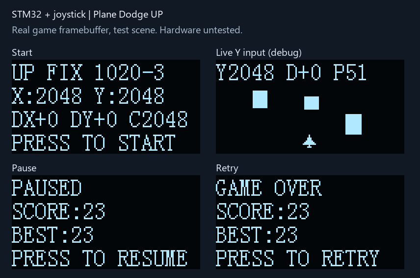

# 摇杆＋OLED 飞机向上避障小游戏

适用于 **STM32F103C8T6、8MHz外部晶振、72MHz系统时钟**，标准外设库 SPL V3.5.0，Keil ARM Compiler 5。独立工程，64KiB Flash / 20KiB SRAM；本例程采用裸机主循环和1ms SysTick，便于先看清输入、游戏逻辑和显示的关系。

本目录是新增的第10项，保留第8项原版。摇杆、OLED引脚与第8项完全相同，已有接线无需移动；OLED保持原来的横屏方向。用户确认只有左右反向，因此X翻转由0改为1，Y翻转恢复并保持原版的1。增加游戏内纵向诊断栏，以排查到顶部后不能下移的问题。

## 玩法

- 上电先松开摇杆，保持自然回中，约160ms稳定采样后进入标题页。
- 垂直按下摇杆开始。向上、下、左、右推动即可移动飞机，也支持斜向移动；松手时飞机位置不变，障碍继续下落。
- 轻推每帧移动1像素，大幅推动每帧移动2像素。飞机被限制在游戏区域内。
- 飞机机头朝上，从屏幕下方中央出发；障碍从飞行区域上沿逐渐进入并向下移动，形成向上飞行的效果。每个障碍完全离开屏幕底边后加1分。
- 每10分提高一级，最高5级；障碍逐渐加快、出现间隔缩短。碰到障碍立即结束。
- 游戏中按下摇杆暂停，再按继续；结束后按下重开。长按不会连续触发。
- BEST保存本次上电以来的最高分；断电后清零，不写Flash。

画面为128×64单色，上方16像素显示分数和等级，下方48像素为飞行区域；障碍入场时不会覆盖计分栏。飞机初始左上角坐标为(59,51)，最大移动范围X=0～119、Y=16～55。飞机9×9像素，透明区域不参与碰撞；实心矩形障碍宽5～11、高6～15像素。游戏采用随机分布，并不保证每种随机局面都有通路。



## 接线

先断电接线。OLED沿用第7项的 **PB14/PB15软件SPI** 接线；与第1～6项PB3/PB5不同。所有模块共地。

| OLED丝印 | STM32引脚 |
|---|---|
| GND | GND |
| VCC | 3.3V |
| D0 / CLK | PB14 |
| D1 / DIN | PB15 |
| RES / RST | PB12 |
| DC | PB1 |
| CS | PB0 |

当前按SSD1306兼容、128×64、七针四线SPI模块实现。原有LTP03A JY模块的实际控制器仍需实板确认；四针IIC屏不能直接接本方案。

| 摇杆标识 | STM32引脚 | 功能 |
|---|---|---|
| VCC / + | **3.3V** | 给两轴电位器供电 |
| GND / - | GND | 共地 |
| X / VRx / X组S | PA0 | ADC1通道0 |
| Y / VRy / Y组S | PA1 | ADC1通道1 |
| Z / SW / K / Z组S | PA2 | 上拉输入，按下接地 |

你提供的PDF介绍的是两轴电位器加一个按键的模拟摇杆，不需要PS2手柄通信协议。有些模块是五针排针，有些如资料图所示分成X/Y/Z三组三针；按实际丝印接各组S、+、-，不要按图片中的物理针序猜接线。

**摇杆用3.3V供电，不要把5V电位器输出直接送入PA0/PA1。** ADC输入范围为0～VREF+，本开发板按3.3V参考设计。PA2内部上拉，默认按下为低电平；若模块Z输出电路不同，需要先核对。原资料第4页Arduino代码把按键脚写成OUTPUT，本工程按按键用途配置为输入，没有照搬该示例。

ADC为12位，读数0～4095，正常中点通常在2048附近；实际中点通过上电校准获得。ADC时钟取72/6=12MHz，采样时间239.5周期，采用两次单通道软件触发转换，不占用DMA和外设中断。

## 编译、下载、首次操作

1. 打开本目录 `Project.uvprojx`，选择ARM Compiler 5，按F7。
2. 通过ST-Link/SWD烧录 `Objects/Project.hex`。使用BIN时地址为 **0x08000000**；BOOT0=0。
3. 松开摇杆再复位。先看到 `CENTER STICK / RELEASE TO CAL`，随后出现 `UP FIX 1020-3`。
4. 按下摇杆开始，确认四个方向与屏幕一致，再测试暂停、碰撞、重新开始。
5. 首次使用若移动方向相反，修改 `User/GameConfig.h` 后重新编译下载。

不需要串口、USB-TTL、电机、MPU6050或FreeRTOS。本工程不操作其他例程中的电机输出引脚。

## 下载成功但看起来像旧程序

已核对用户提供的下载日志：加载的是本目录Objects/Project.axf，Erase Done、Programming Done、Verify OK、Application running均成功；当时Code=10964也与该次生成固件一致。因此该次日志不能支持“下载失败”的判断。功能异常是否解决，需要另看实板输入和位置。

为直接辨认，本次在标题和校准页第1行加入固定版本标识 **UP FIX 1020-3**。这份带标识固件的构建日志Code=10948、RO-data=1832、RW-data=76、ZI-data=2140；HEX映像跨度12856B，0错误0警告。

使用Keil时打开本目录Project.uvprojx，重新编译后点击Download，确认Load路径仍指向本目录的Objects/Project.axf。下载结束后松开摇杆并按板上RESET，开始页应显示UP FIX 1020-3；不要以飞机仍朝上、障碍仍下落判断版本，因为玩法保持一致。

若版本号可见而顶部仍不能下移，记录游戏顶部Y/D/P；此时应继续定位当前固件的实际行为。若版本号不可见，则结合复位后的画面、完整下载路径和日志继续排查。不要在没有证据时改动SWD接线、做全片擦除或更改读保护。

## 调整手感与方向

| 参数 | 默认值 | 作用 |
|---|---:|---|
| STICK_SWAP_XY | 0 | 横竖轴颠倒时设1 |
| STICK_INVERT_X | 1 | 假定右推时PA0下降；左右相反时切换0/1 |
| STICK_INVERT_Y | 1 | 保持原版上下映射，按用户确认不改变Y方向 |
| STICK_DEAD_ZONE | 300 | 相对校准中点的死区，松手漂移可适当增大 |
| STICK_FAST_ZONE | 1100 | 超过该偏差每帧移动2像素 |
| STICK_DEBOUNCE_SAMPLES | 4 | 5ms采样下，连续稳定约20ms确认按键 |
| GAME_FRAME_MS | 40 | 逻辑更新间隔，默认目标25帧/秒 |
| GAME_INPUT_DEBUG | 1 | 顶部临时显示Y/D/P，设0恢复分数/等级显示 |

先交换X/Y，再分别翻转方向。屏幕左上角为原点，X增大向右、Y增大向下。阈值基于ADC计数，必须保持死区小于快速区。修改帧周期会同时改变飞机和障碍速度；需要相应调整Game.c中的生成节奏。

上电校准要求32个有效样本，每轴跨度不超过200，中点落在1024～3071范围内；校准时不要握住摇杆偏向某一侧。校准不会识别机械中点，只会采用当时稳定的电压。若一直提示回中，检查供电、共地、信号线及是否真正松手。

## 方向校验与顶部不能下移的排查

用户已确认：**只有左右相反；上下原来正确；只在到最上边后出现不能下移，此时仍是游戏画面，左右可以移动。** 因此本版将STICK_INVERT_X设为1，只修正左右；STICK_INVERT_Y恢复原版的1，STICK_SWAP_XY保持0。接线不变。

顶部移动改为四个方向分别检查边界：Y=16时只阻止向上，向下独立判断；X到左右边界也不影响Y。保留每像素子步碰撞、最终限幅和所有计分逻辑。

标题页显示实时原始值 `X:xxxx Y:xxxx`，下一行 `DX+0 DY+0 C2048` 中C为校准中点Y。正确输出为：

| 动作 | 输入 |
|---|---|
| 松手回中 | DX=0，DY=0 |
| 向上推 | DY=-1或-2 |
| 向下推 | DY=+1或+2 |
| 向左推 | DX=-1或-2 |
| 向右推 | DX=+1或+2 |

为了在异常现场定位，GAME_INPUT_DEBUG默认开启。运行时顶部暂时以 `Y2048 D+0 P51` 替代分数/等级：Y为PA1原始采样，D为实际送入游戏的DY，P为飞机左上角Y坐标（16～55）。分数照常累计，暂停/结束页照常显示分数和最高分。排查结束后设GAME_INPUT_DEBUG=0，再编译烧录即可恢复正常计分栏。

若再次在顶边不能下移，保持向下推动并记录顶部这一行：

- D为+1/+2、P从16增大：逻辑正在向下；如画面看起来不动，可继续查显示刷新。
- D为0：下推没有超过死区，对照标题页的中点C与现场Y看偏差是否超过300。
- D为-1/-2：采样被判断为上移，对照原始Y判断方向/接线/校准。
- D持续为+1/+2，但P一直为16：实际执行与当前测试模型不符，需要基于这组现场证据继续查。

电脑端用真实StickInput.c→Game.c验证三个中点1200/2048/2900的到顶反向、到底反向、左右往返，并增加“贴顶横移100帧→略过死区的慢档下推→快档下推”：包括居中、左端、右端三种横向输入，都能立即离开顶边，且无需松手或重开。旧代码尚未在电脑端复现独立的边界锁住问题；此次明确边界判断和诊断，仍需实板确认，不能将测试通过等同于已确认现场根因。

复位校准时保持松手。修改源码后必须重新编译、重新烧录；本版运行时应能看到Y/D/P栏，可用于确认烧录的是当前固件。

## 障碍速度与生成节奏

默认每帧40ms，首个障碍在开始后约800ms生成。障碍宽5～11、高6～15像素，X随机覆盖0～(128-宽度)，初始Y=16-高度；之后向下移动，Y达到64才计分并释放。

| 等级 | 分数 | 下落速度（像素/帧） | 生成间隔 |
|---|---|---:|---|
| 1 | 0～9 | 1 | 25帧，1000ms |
| 2 | 10～19 | 1 | 22帧，880ms |
| 3 | 20～29 | 2 | 19帧，760ms |
| 4 | 30～39 | 2 | 16帧，640ms |
| 5 | 40及以上 | 3 | 13帧，520ms |

## 代码阅读顺序

1. `User/main.c`：5ms采样、40ms游戏步进，空闲时反复调用OLED_Service。
2. `Hardware/Joystick.c`：GPIO、ADC上电校准、通道切换、转换超时。
3. `System/StickInput.c`：回中校准、死区、方向转换、按键消抖和单次事件。
4. `System/Game.c`：朝上飞机点阵、下落障碍、标题/运行/暂停/结束状态、边界、随机位置、分数和逐像素碰撞。
5. `System/GameView.c`：将当前状态绘制到OLED显存；障碍只画在Y=16～63，保护计分栏。
6. `Hardware/OLED.c`、`OLED_SPI.c`：复用既有页显存和软件SPI驱动。

游戏固定步长，每帧分成三个子步检测移动与碰撞，避免飞机和快速障碍相向移动时穿透。使用固定数组保存最多6个障碍，不使用动态内存；伪随机种子混入开始时刻和ADC读数，不用于安全用途。

ADC上电校准等待最多10ms，单次转换等待最多2ms，均依赖已启动的SysTick。采样超时后停止推进游戏，进入暂停并清除旧输入；转换恢复后重新回中校准，再按键恢复。初始化失败显示ADC ERROR，需检查后复位。超时只能检测ADC转换流程，**不能可靠检测摇杆是否插上**，悬空模拟输入仍可能产生读数。

OLED_Service每次最多发8字节，主循环不使用40ms阻塞延时。绘制时先清软件显存再重画；实际刷新速度和撕裂情况仍需面板实测。若CPU无法在40ms内完成一次循环，游戏放慢而不突发补帧。SPI是单向输出，Ready不代表屏幕已连接。

## 验证状态

已完成Keil ARMCC5重建：**0错误、0警告**。HEX Flash跨度12856B，静态RAM区域2216B（含启动栈），低于官方64KiB/20KiB限制。HEX校验、内存范围和SysTick向量绑定检查通过。

电脑端运行真实Game.c、StickInput.c、GameView.c和OLED.c，Visual Studio `/W4 /WX` 编译，通过回中/抖动/死区、长按/消抖、四向边界、暂停/恢复/重开、透明像素碰撞、相向移动碰撞、分数饱和、随机障碍边界，以及显存刷新一致性测试。另验证5个等级的下落速度、上沿外生成、底边完全离屏后只计分一次、顶部计分栏逐字节不变、右下边界裁剪，以及10000步随机运行。预览图由测试导出的真实显存生成，分数和障碍来自测试场景。

```powershell
# 仓库根目录
powershell -NoProfile -ExecutionPolicy Bypass -File .\tools\test_game_up.ps1
python .\tools\render_game_up_preview.py
python .\tools\check_projects.py
```

**尚未实板烧录。** 待测：OLED控制器兼容与刷新流畅度、摇杆真实轴方向和中点漂移、Z按键电平、ADC接线/供电、运行手感和长期稳定性。电脑端测试没有模拟ADC电气行为或MCU指令执行。

## 参考资料

- 用户提供的《双轴按键摇杆传感器 PS2游戏摇杆控制杆传感器模块 电子积木模块----.pdf》：第1～2页的两轴模拟输出、Z数字输出和电位器原理；其中Arduino接法和示例代码仅作为资料。
- [ST STM32F103x8/xB数据手册](https://www.st.com/resource/en/datasheet/stm32f103c8.pdf)：ADC输入电压、时钟上限、通道引脚。
- 本仓库第6项的时基/中断文件和第7项的OLED软件SPI驱动；Start/Library保留厂商原版权声明。
