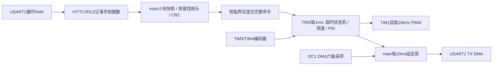

# ROS移动机器人STM32下层控制器

本例程沿用仓库独立Keil工程、SPL、中文注释及 `User / System / Hardware / Start / Library` 格式。目标为 **STM32F103C8T6，8MHz HSE，72MHz，64KiB Flash / 20KiB SRAM**，双轮差速、TB6612双通道、MPU6050。打开本目录 `Project.uvprojx` 编译。没有使用HAL或RTOS，没有加入OLED，二进制通信串口不能混入文本日志。

这是具备真实外设驱动的台架例程；编码器参数、PID、电机极性及机械停机距离仍需实物标定。ROS1桥接示例在 `../ros1/mobile_robot_bridge`，协议也可直接用于ROS2。

## 从哪里开始阅读代码

建议先读 `User/main.c` 的初始化顺序，再读 `System/RobotApp.c` 的两个入口：

- `RobotApp_Tick()`：由 TIM2 每 1ms 调用，读取编码器和急停，运行控制算法，更新电机输出。
- `RobotApp_Service()`：由 main 持续调用，刷新存活时间、处理接收错误、解析命令、推进 IMU 采样并发送反馈。

| 文件 | 职责 | 关注内容 |
|---|---|---|
| `User/RobotConfig.h` | 集中配置 | 编码器每圈计数与极性、RPM 上限、超时、周期、PID 和斜坡参数 |
| `System/RobotApp.c/.h` | 连接业务与硬件 | 初始化、main/中断分工、短临界区、反馈字段 |
| `System/RobotControl.c/.h` | 不依赖外设的控制核心 | 六种状态、命令序号、测速、斜坡、PID、停机锁定 |
| `System/RobotProtocol.c/.h` | 字节协议 | 小端读写、CRC、滑窗重同步；不直接控制电机 |
| `Hardware/Motor.c/.h` | TB6612 输出与急停输入 | 引脚对应、方向切换、TIM1 PWM、共用 STBY |
| `Hardware/Encoder.c/.h` | 编码器硬件计数 | 左 TIM3/右 TIM4、16 位回绕、单次增量与极性 |
| `Hardware/Serial.c/.h` | USART1 与 DMA | RX 累计生产/消费位置、覆盖检测、TX 忙与超时 |
| `Hardware/IMU.c/.h` | MPU6050 采样 | 配置寄存器顺序、六轴字节解码、有效期、失败重试 |
| `Hardware/IIC.c/.h` | 异步 I2C1 事务 | START/ADDR/DMA/BTF/STOP 状态，事务结果消费 |
| `System/Timer.c/.h` | 控制节拍 | TIM2 1ms 更新中断，抢占优先级 1 |
| `System/Delay.c/.h` | 公共毫秒时基 | SysTick、时钟校验、时间差与回绕 |
| `User/stm32f10x_it.c/.h` | 公共异常 | SysTick 入口、故障关闭电机、调试断点 |

`Start/` 是芯片启动与 CMSIS 文件，`Library/` 是 ST 标准外设库；保持厂商代码格式。`User/stm32f10x_conf.h` 是 SPL 配置，`User/STM32F103C8.sct` 是链接内存布局，`Project.uvprojx` 是 Keil 工程入口。

### 数据和单位约定

| 数据 | 约定 |
|---|---|
| 双轮数组、`Wheel` 参数 | 下标 0 为左轮，1 为右轮；`Encoder_Get()` 只允许这两个值 |
| `Target / Ramp / Speed` | 分别为命令目标、斜坡目标、滤波测量速度，单位都是 RPM |
| `PWM` | -1000..1000，符号决定方向，绝对值表示千分比占空比 |
| 编码器 `Counts` | `uint32` 累计模计数；`Encoder_Get()` 返回本次与上次读取的有符号增量 |
| 控制时间 | `Robot.Now / LastCommand / DecelStart / MainTick` 使用 TIM2 控制毫秒计数 |
| 采集和通信时间 | `Delay_GetTick()` 使用 SysTick 公共毫秒计数；不与控制计数混合计算时间差 |
| I2C 地址和事务结果 | API 使用未左移的 7 位地址；启动返回 `IIC_OK` 后仍需等待并消费完成结果 |
| IMU 原始值 | AX、AY、AZ、GX、GY、GZ；使用前检查 `Valid`，换算见协议一节 |

### 两条关键调用链

```text
main -> RobotApp_Service -> Serial_ReadBlock -> Robot_ParseByte
     -> 短临界区内 RobotControl_Command -> 更新完整目标/状态

TIM2_IRQHandler -> RobotApp_Tick -> Encoder_Get + Motor_Emergency
                -> RobotControl_Tick -> Motor_SetPWM 或 Motor_Stop
```

控制核心的 `PWM` 是计算结果，实际 GPIO 和定时器操作在 `Motor.c`。协议解析成功只代表帧结构有效，控制核心还会检查命令序号、RPM 和当前状态。main 更新控制状态或复制反馈快照时保存并恢复 `PRIMASK`；复制 DMA 接收数据还需要检查复制前后的生产位置，具体流程见“接收一致性”。

### 排版与维护

自编 C/H 文件采用一行一条语句、函数与控制块左花括号换行、描述性局部变量、中文职责和接口注释。目录中的 `.clang-format` 固定这些排版约定；仅对 `Hardware/`、`System/` 和自编 `User/` 文件使用，保留厂商库格式。头文件说明调用位置、单位和返回值，源文件侧重解释状态变化、时序和并发原因。

## 默认周期及分工

| 工作 | 周期/位置 | 说明 |
|---|---|---|
| 控制/编码器/命令超时/实体急停采样 | TIM2，1ms | 优先级1；无打印、延时、串口解析、I2C等待 |
| UART RX | USART1循环DMA，256字节 | HT/TC/IDLE只记事件及圈数；TC额外维护累计生产位置 |
| 命令解析 | main，每轮最多256字节 | 每次取32字节到CPU局部快照，再解析固定48字节帧 |
| IMU采集 | main，约10ms | I2C1+DMA+EV/ER异步状态机，失败1s重试 |
| 编码器/IMU/状态反馈 | main，10ms | 单帧48字节DMA TX，不排队旧遥测，忙则跳过 |
| 上位机命令 | 建议20ms，50Hz | 200ms无新有效使能命令进入减速 |
| main存活检查 | TIM2，100ms | main不再更新存活时间则立即故障待机 |

10ms反馈在115200/8N1下占用单向带宽约41.7%（48×100×10/115200），每帧约4.17ms。50Hz下行约20.8%；全双工分别核算。修改 `User/RobotConfig.h` 的 `ROBOT_FEEDBACK_MS` 可改20ms；不建议直接把48字节反馈设成1ms。



## 接线与资源

| 功能 | 引脚/外设 |
|---|---|
| 上位机串口TX/RX | PA9 / PA10，USART1，115200 8N1 |
| 左编码器A/B | PA6 / PA7，TIM3 |
| 右编码器A/B | PB6 / PB7，TIM4 |
| 左电机PWMA、AIN1、AIN2 | PA8（TIM1_CH1）、PA4、PA5 |
| 右电机PWMB、BIN1、BIN2 | PA11（TIM1_CH4）、PB0、PB1 |
| TB6612 STBY | PB13，低电平待机 |
| 急停输入 | PB12，上拉，按键接GND，低电平有效，释放不会自动恢复 |
| MPU6050 SCL/SDA | PB8 / PB9，I2C1重映射，外接上拉至3.3V |
| MPU6050 AD0 | 接GND，7位地址0x68 |
| SWD | PA13 / PA14，保持可用 |

USART1 TX/RX使用DMA1通道4/5，I2C1 TX/RX使用通道6/7。**不能直接复用第二例的I2C2**：I2C2也占用通道4/5，与USART1冲突。本例复制其状态机后改为I2C1并重映射到PB8/9，以避开TIM4的PB6/7。PA11不再用于USB。

编码器必须是3.3V兼容信号，各模块共地，电机经驱动器供电，STM32引脚不直接接电机。默认输出轴每圈1320计数仅为示例；核实“电机轴PPR×四倍频×减速比”。抬轮手转检查左右增量符号，修改 `ROBOT_ENCODER_LEFT/RIGHT`，再低速调参。

## 接收一致性

1. DMA始终循环接收，IDLE不代表帧边界。连续无间隙数据仍由HT/TC唤醒main。
2. TC中断维护圈数，main短暂保存PRIMASK、关IRQ，读取“圈数+NDTR”。若TC已到但ISR未处理，则补计一圈。离开临界区恢复原PRIMASK，不无条件开中断。
3. main复制最多32字节后再次读取生产位置。如果复制期间旧数据已被覆盖，整块丢弃，清解析器并锁定FAULT。**屏蔽CPU中断不会暂停DMA**，所以不能仅靠关中断保护DMA缓冲区。
4. 解析器处理CPU私有副本。合法帧的左右目标、标志、序号、超时时间在同一短临界区提交；TIM2不会读取半条命令。反馈同样先快照控制状态，再在临界区外编码及发DMA。
5. main必须及时运行；256字节在满速下约22.2ms填满一圈。普通前台阻塞超过一圈可通过累计生产位置检测。**不允许全局屏蔽中断或阻塞同级通信ISR长达一整圈**：TC标志不能记录多次未处理回绕。实板需测量最坏ISR时长及临界区延迟，确保控制ISR小于1ms、通信IRQ延迟远小于22ms。

## 固定48字节协议

所有多字节整数为**小端**。禁止直接发送C结构体，避免对齐与平台差异。CRC16/CCITT-FALSE：poly=0x1021、init=0xFFFF、无反射、xorout=0，覆盖字节0..43；CRC值自身按小端存放。标准测试 `123456789 → 0x29B1`。

| 偏移 | 大小 | 下行命令（type=0x01） | 上行反馈（type=0x81） |
|---|---|---|---|
| 0 | 2 | AA 55 | AA 55 |
| 2 | 1 | 版本1 | 版本1 |
| 3 | 1 | 类型01 | 类型81 |
| 4 | 1 | 总长度48，即0x30 | 同左 |
| 5 | 1 | 必须0 | 状态0..5 |
| 6 | 2 | uint16递增序号 | uint16反馈序号 |
| 8 | 4 | int16左RPM、int16右RPM | uint32控制毫秒计数 |
| 12 | 1/8 | 命令flags，后续13..43必须0 | 12..15左累计编码器、16..19右累计编码器，均uint32模计数 |
| 20 | 4 | 保留0 | int16左RPM、int16右RPM |
| 24 | 12 | 保留0 | int16 AX/AY/AZ/GX/GY/GZ |
| 36 | 2 | 保留0 | IMU样本年龄ms；65535=无效 |
| 38 | 1 | 保留0 | IMU有效标志 |
| 39 | 1 | 保留0 | 实体急停按下标志 |
| 40 | 2 | 保留0 | 坏候选帧次数低16位 |
| 42 | 2 | 保留0 | UART/DMA错误+覆盖次数低16位 |
| 44 | 2 | CRC16 | CRC16 |
| 46 | 2 | 0D 0A | 0D 0A |

flags：bit0=ENABLE、bit1=ESTOP、bit2=CLEAR。普通运动只用1；停机用0；急停用2；清除用4且左右目标必须0。CLEAR与ENABLE不能同时使用，未知位和非零保留字段拒绝。完整CRC正确后，ESTOP优先于序号及RPM检查，使旧序号急停依然有效。

序号按uint16回绕比较，差值1..32767认为更新；重复及旧序号不更新速度，也**不刷新通信超时**。序号窗口要求相邻有效命令不跨越32768帧。CLEAR允许已停状态重新同步序号，供上位机进程重启使用；这不是抗重放认证协议。

编码器累计使用uint32自然回绕，差分时作模运算得到有符号增量。RPM反馈限幅至int16。IMU量程显式配置为±2g、±250°/s，DLPF约44Hz、内部采样100Hz：加速度=raw×9.80665/16384 m/s²，角速度=raw×π/(180×131) rad/s。样本时间取本次I2C读启动时间，尚未与主机时钟同步；六轴数据不包含姿态解算。

## 异常与状态机

| 状态 | 数值 | 输出与恢复规则 |
|---|---|---|
| STOP | 0 | 上电及正常禁用，PWM关闭；新ENABLE可启动 |
| RUN | 1 | 1ms测速、目标斜坡、PID+前馈 |
| DECEL | 2 | 200ms无新有效命令，目标降为0，斜坡每ms最多下降0.6RPM，PID继续闭环 |
| TIMEOUT | 3 | DECEL最多600ms后PWM关闭并锁定；零目标CLEAR→STOP，再新ENABLE |
| EMERGENCY | 4 | 实体急停或有效ESTOP，PWM清零、STBY拉低并锁定；按钮释放后CLEAR→STOP |
| FAULT | 5 | UART/DMA错误、缓冲区覆盖或main停转100ms，立即关闭输出并锁定；排除故障后CLEAR→STOP |

DECEL中显式禁用会立即关闭输出并转TIMEOUT锁定。

帧头/版本/类型/长度/尾部/CRC/保留字段错误：候选帧只移走一个字节，继续找AA 55；分片残帧保留，超过50ms无新数据丢弃。错误帧本身不立即硬停，依赖“最后有效命令时间”进入超时。单次线路/DMA/覆盖错误则认为接收完整性已丢失，进入FAULT，清除残帧。

超时策略衰减**目标速度**，不递减PID增益，否则负载变化时控制能力会一同减弱。进入减速清掉旧积分，积分限幅并做饱和抗积累；600ms是最终切断上限，**不能据此保证机械已经停止**。DECEL期间即使通信恢复也不自动恢复运动，先等待TIMEOUT，再CLEAR与重新使能。

急停关闭PWM并将TB6612置待机，高阻滑行，**不是主动短路制动**。实体按键由1ms定时采样，实际响应还包含IRQ延迟；更严格的停机时间应由实体急停直接切驱动使能/电源。本例未实现独立硬件急停回路、IWDG、堵转/过流/编码器断线保护；main检测依赖TIM2仍能运行。方向反转留一个1ms空档。两个通道共享STBY，单轮零PWM时的行为以TB6612真值表为准。

IMU失败不会阻塞控制：标记无效、累计错误、重新初始化I2C并延时重试；当前速度控制只依赖编码器，故IMU缺失不触发停机。若导航依赖IMU，可在应用层增加传感器失效停机条件。外部SDA/SCL被持续拉低需要排查接线，本例没有用GPIO发九脉冲恢复卡死从机。

TX DMA忙则跳过当前反馈，不阻塞控制；20ms未完成则中止发送并进入通信FAULT。DMA发送完成只代表数据写入USART，尾字节离开引脚还需USART TC；本例全双工TTL不切换RS485方向，也不在DMA TC时关USART。

可在调试器观察 `Parser.Bad/Good`（坏/好候选帧）、`RejectedCommands`（控制核心拒绝命令数）、`SkippedFeedback`（发送忙跳过反馈数）、`IMU_Data.Errors`（IMU 错误数）。这些静态变量分别位于 `RobotApp.c` 和 `IMU.c`。反馈中的错误统计是低16位累计值，不是故障原因编码。

## 验证与台架步骤

仓库根目录运行：

```powershell
powershell -NoProfile -ExecutionPolicy Bypass -File tools/test_robot.ps1
```

测试直接编译真实C协议与控制核心，覆盖CRC标准向量、分片、每个字节损坏/插入/删除后的重同步、CRC正确但语义错误、序号回绕/重复/乱序、越界目标、超时减速、锁定恢复、实体/远程急停、main停转与毫秒回绕。Python与C生成的命令逐字节交叉比对。此测试不模拟STM32外设。

1. 不接电机供电，编译下载，确认上电STBY低、两路PWM为0；串口收到type81状态STOP。
2. 按说明接编码器，手转检查左右计数方向和每圈计数；示波器观察PWM频率20kHz。
3. 抬轮，正确零目标CLEAR后低速ENABLE，发送每20ms更新序号的命令；标定PID及速度正负方向。
4. 拔掉上位机TX，确认最后有效命令约200ms后进入DECEL，最晚再600ms进入TIMEOUT；恢复串口不自动转动。
5. 按PB12急停，确认STBY低且状态4；释放后仍锁定，必须CLEAR且重新使能。
6. 连续发送重复帧、错CRC帧、粘包及无IDLE长数据，检查不刷新命令超时；长时间阻塞main验证FAULT。
7. 拔IMU验证反馈有效位清零，编码器闭环仍运行；接回后检查重试。
8. GPIO翻转或DWT测量TIM2最坏执行时间、全局临界区和通信延迟，验证负载下没有1ms控制超期及DMA覆盖。

本次电脑验证见 `验证记录.md`；实板、ROS运行及机械响应不能由编译/主机回归代替。

外设机制依据：[ST RM0008](https://www.st.com/resource/en/reference_manual/rm0008-stm32f103xx-advanced-armbased-32bit-mcus-stmicroelectronics.pdf)、[ST AN3109 DMA接收FIFO说明](https://www.st.com.cn/resource/en/application_note/an3109-communication-peripheral-fifo-emulation-with-dma-and-dma-timeout-in-stm32f10x-microcontrollers-stmicroelectronics.pdf)。周期和异常策略为本例工程设计参数。
