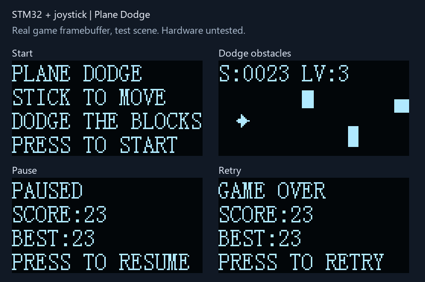

# 摇杆＋OLED 飞机避障小游戏

适用于 **STM32F103C8T6、8MHz外部晶振、72MHz系统时钟**，标准外设库 SPL V3.5.0，Keil ARM Compiler 5。独立工程，64KiB Flash / 20KiB SRAM；本例程采用裸机主循环和1ms SysTick，便于先看清输入、游戏逻辑和显示的关系。

## 玩法

- 上电先松开摇杆，保持自然回中，约160ms稳定采样后进入标题页。
- 垂直按下摇杆开始。向上、下、左、右推动即可移动飞机，也支持斜向移动；松手停止。
- 轻推每帧移动1像素，大幅推动每帧移动2像素。飞机被限制在游戏区域内。
- 障碍从右往左移动，必须躲开；每个障碍完全离开屏幕左边后加1分。
- 每10分提高一级，最高5级；障碍逐渐加快、出现间隔缩短。碰到障碍立即结束。
- 游戏中按下摇杆暂停，再按继续；结束后按下重开。长按不会连续触发。
- BEST保存本次上电以来的最高分；断电后清零，不写Flash。

画面为128×64单色，上方16像素显示分数和等级，下方48像素为飞行区域。飞机9×9像素，透明区域不参与碰撞；实心矩形障碍宽5～11、高6～15像素。游戏采用随机分布，并不保证每种随机局面都有通路。



## 接线

先断电接线。OLED沿用第7项的 **PB14/PB15软件SPI** 接线；与第1～6项PB3/PB5不同。所有模块共地。

| OLED丝印 | STM32引脚 |
|---|---|
| GND | GND |
| VCC | 3.3V |
| D0 / CLK | PB14 |
| D1 / DIN | PB15 |
| RES / RST | PB12 |
| DC | PB1 |
| CS | PB0 |

当前按SSD1306兼容、128×64、七针四线SPI模块实现。原有LTP03A JY模块的实际控制器仍需实板确认；四针IIC屏不能直接接本方案。

| 摇杆标识 | STM32引脚 | 功能 |
|---|---|---|
| VCC / + | **3.3V** | 给两轴电位器供电 |
| GND / - | GND | 共地 |
| X / VRx / X组S | PA0 | ADC1通道0 |
| Y / VRy / Y组S | PA1 | ADC1通道1 |
| Z / SW / K / Z组S | PA2 | 上拉输入，按下接地 |

你提供的PDF介绍的是两轴电位器加一个按键的模拟摇杆，不需要PS2手柄通信协议。有些模块是五针排针，有些如资料图所示分成X/Y/Z三组三针；按实际丝印接各组S、+、-，不要按图片中的物理针序猜接线。

**摇杆用3.3V供电，不要把5V电位器输出直接送入PA0/PA1。** ADC输入范围为0～VREF+，本开发板按3.3V参考设计。PA2内部上拉，默认按下为低电平；若模块Z输出电路不同，需要先核对。原资料第4页Arduino代码把按键脚写成OUTPUT，本工程按按键用途配置为输入，没有照搬该示例。

ADC为12位，读数0～4095，正常中点通常在2048附近；实际中点通过上电校准获得。ADC时钟取72/6=12MHz，采样时间239.5周期，采用两次单通道软件触发转换，不占用DMA和外设中断。

## 编译、下载、首次操作

1. 打开本目录 `Project.uvprojx`，选择ARM Compiler 5，按F7。
2. 通过ST-Link/SWD烧录 `Objects/Project.hex`。使用BIN时地址为 **0x08000000**；BOOT0=0。
3. 松开摇杆再复位。先看到 `CENTER STICK / RELEASE TO CAL`，随后出现 `PLANE DODGE`。
4. 按下摇杆开始，确认四个方向与屏幕一致，再测试暂停、碰撞、重新开始。
5. 首次使用若移动方向相反，修改 `User/GameConfig.h` 后重新编译下载。

不需要串口、USB-TTL、电机、MPU6050或FreeRTOS。本工程不操作其他例程中的电机输出引脚。

## 调整手感与方向

| 参数 | 默认值 | 作用 |
|---|---:|---|
| STICK_SWAP_XY | 0 | 横竖轴颠倒时设1 |
| STICK_INVERT_X | 0 | 左右相反时切换0/1 |
| STICK_INVERT_Y | 1 | 上下相反时切换0/1 |
| STICK_DEAD_ZONE | 300 | 相对校准中点的死区，松手漂移可适当增大 |
| STICK_FAST_ZONE | 1100 | 超过该偏差每帧移动2像素 |
| STICK_DEBOUNCE_SAMPLES | 4 | 5ms采样下，连续稳定约20ms确认按键 |
| GAME_FRAME_MS | 40 | 逻辑更新间隔，默认目标25帧/秒 |

先交换X/Y，再分别翻转方向。屏幕左上角为原点，X增大向右、Y增大向下。阈值基于ADC计数，必须保持死区小于快速区。修改帧周期会同时改变飞机和障碍速度；需要相应调整Game.c中的生成节奏。

上电校准要求32个有效样本，每轴跨度不超过200，中点落在1024～3071范围内；校准时不要握住摇杆偏向某一侧。校准不会识别机械中点，只会采用当时稳定的电压。若一直提示回中，检查供电、共地、信号线及是否真正松手。

## 代码阅读顺序

1. `User/main.c`：5ms采样、40ms游戏步进，空闲时反复调用OLED_Service。
2. `Hardware/Joystick.c`：GPIO、ADC上电校准、通道切换、转换超时。
3. `System/StickInput.c`：回中校准、死区、方向转换、按键消抖和单次事件。
4. `System/Game.c`：标题/运行/暂停/结束状态、边界、随机障碍、分数、逐像素碰撞。
5. `System/GameView.c`：将当前状态绘制到OLED显存，和硬件输入分开。
6. `Hardware/OLED.c`、`OLED_SPI.c`：复用既有页显存和软件SPI驱动。

游戏固定步长，每帧分成三个子步检测移动与碰撞，避免飞机和快速障碍相向移动时穿透。使用固定数组保存最多6个障碍，不使用动态内存；伪随机种子混入开始时刻和ADC读数，不用于安全用途。

ADC上电校准等待最多10ms，单次转换等待最多2ms，均依赖已启动的SysTick。采样超时后停止推进游戏，进入暂停并清除旧输入；转换恢复后重新回中校准，再按键恢复。初始化失败显示ADC ERROR，需检查后复位。超时只能检测ADC转换流程，**不能可靠检测摇杆是否插上**，悬空模拟输入仍可能产生读数。

OLED_Service每次最多发8字节，主循环不使用40ms阻塞延时。绘制时先清软件显存再重画；实际刷新速度和撕裂情况仍需面板实测。若CPU无法在40ms内完成一次循环，游戏放慢而不突发补帧。SPI是单向输出，Ready不代表屏幕已连接。

## 验证状态

已完成Keil ARMCC5重建：**0错误、0警告**。HEX Flash跨度12640B，静态RAM区域2216B（含启动栈），低于官方64KiB/20KiB限制。HEX校验、内存范围和SysTick向量绑定检查通过。

电脑端运行真实Game.c、StickInput.c、GameView.c和OLED.c，Visual Studio `/W4 /WX` 编译，通过回中/抖动/死区、长按/消抖、四向边界、暂停/恢复/重开、透明像素碰撞、相向移动碰撞、分数饱和、随机障碍边界，以及显存刷新一致性测试。预览图由测试导出的真实显存生成，分数和障碍来自测试场景。

```powershell
# 仓库根目录
powershell -NoProfile -ExecutionPolicy Bypass -File .\tools\test_game.ps1
python .\tools\render_game_preview.py
python .\tools\check_projects.py
```

**尚未实板烧录。** 待测：OLED控制器兼容与刷新流畅度、摇杆真实轴方向和中点漂移、Z按键电平、ADC接线/供电、运行手感和长期稳定性。电脑端测试没有模拟ADC电气行为或MCU指令执行。

## 参考资料

- 用户提供的《双轴按键摇杆传感器 PS2游戏摇杆控制杆传感器模块 电子积木模块----.pdf》：第1～2页的两轴模拟输出、Z数字输出和电位器原理；其中Arduino接法和示例代码仅作为资料。
- [ST STM32F103x8/xB数据手册](https://www.st.com/resource/en/datasheet/stm32f103c8.pdf)：ADC输入电压、时钟上限、通道引脚。
- 本仓库第6项的时基/中断文件和第7项的OLED软件SPI驱动；Start/Library保留厂商原版权声明。
