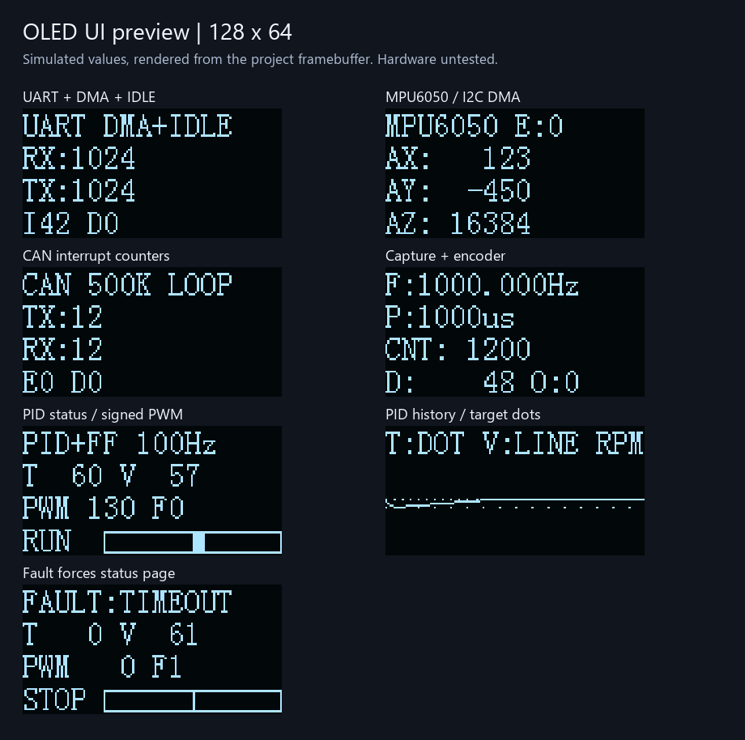
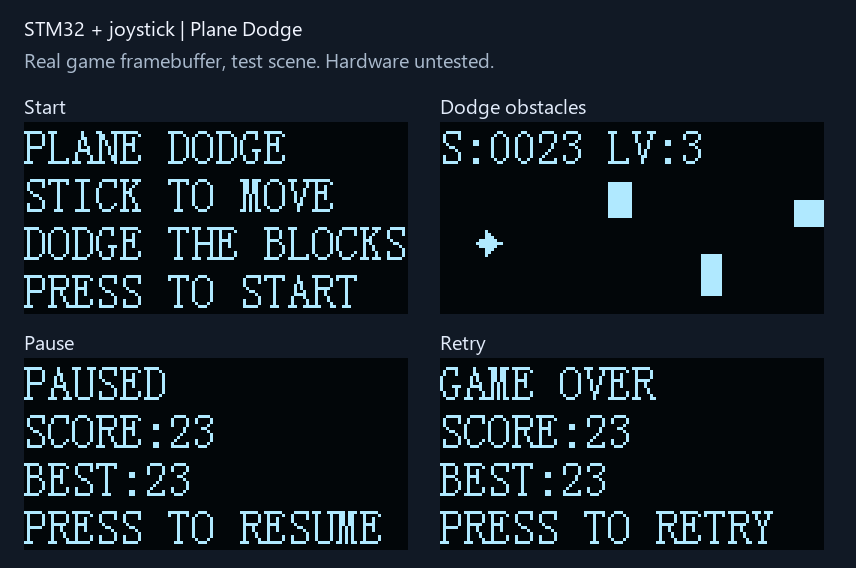

# STM32F103C8T6 进阶例程（中文注释版）

已按你提供的 `STM32Project-有注释版` 重写。每个例程都是**独立 Keil 工程**，沿用 `Start / Library / User / System / Hardware / Objects / Listings` 目录、`Serial_Init()` / `Encoder_Get()` 这类命名、中文函数说明、花括号另起一行和分段初始化注释。

## 九个工程

| 目录 | 实现内容 | 打开方式 |
|---|---|---|
| [1-1 UART+DMA+空闲中断](<1-1 UART+DMA+空闲中断/说明.md>) | USART1 循环 DMA 接收、HT/TC/IDLE 中断、软件 FIFO、DMA 发送回显 | 目录内 `Project.uvprojx` |
| [2-1 IIC+DMA+中断](<2-1 IIC+DMA+中断/说明.md>) | 硬件 I2C2、收发 DMA、EV/ER 中断状态机、MPU6050 连续读取 | 同上 |
| [3-1 CAN+中断](<3-1 CAN+中断/说明.md>) | CAN1 异步发送、TX/RX 中断、接收队列、内部回环/正常总线 | 同上 |
| [4-1 TIM输入捕获+编码器](<4-1 TIM输入捕获+编码器/说明.md>) | TIM2 输入捕获测周期、溢出扩展、TIM3 AB 相编码器读取 | 同上 |
| [5-1 定时器PID前馈速度闭环](<5-1 定时器PID前馈速度闭环/说明.md>) | 10ms 控制周期、编码器测速、PID+前馈、TB6612 PWM、串口目标 RPM | 同上 |
| [6-1 SPI OLED显示](<6-1 SPI OLED显示/说明.md>) | 硬件SPI1、SSD1306页显存、文字/条形图/曲线、分块刷新 | 同上 |
| [7-1 FreeRTOS多任务+UART+OLED](<7-1 FreeRTOS多任务+UART+OLED/说明.md>) | 官方FreeRTOS V11.2.0、UART DMA任务通知、LED队列、OLED任务、资源诊断 | 同上 |
| [8-1 摇杆OLED飞机避障](<8-1 摇杆OLED飞机避障/说明.md>) | 双轴ADC摇杆、按键消抖、飞机四向移动、随机障碍、碰撞/计分/暂停/重开 | 同上 |
| [9-1 串口ROS双向遥控](<9-1 串口ROS双向遥控/说明.md>) | 摇杆输入、USART1 DMA双向协议、ROS Noetic接收桥、AUBO关节反馈OLED、超时处理 | 同上 |

**OLED使用SPI。** 第1～6项使用PB3 SCK、PB5 MOSI、PB0 CS、PB1 DC、PB12 RES。第7～9项按面包板方案改用普通GPIO软件SPI：**PB14 SCK、PB15 MOSI**，CS/DC/RES不变，避免调试引脚重映射；切换工程时注意这两根线。详见 [OLED接线与显示](docs/OLED接线与显示.md)。IIC例程仍用I2C2连接MPU6050，屏幕走独立SPI。

你提供的“0.96寸 LTP03A JY”丝印尚无可靠控制器资料可核实；当前按**128×64、SSD1306兼容、四线SPI控制方式的七针模块**实现，兼容性仍需实板确认。若模块只引出四针IIC，不能仅改软件就变成SPI接口。



原先的九例程切换工程与 `App/BSP/Examples` 目录已移除。参考资料所在目录仅用于读取，未作修改。

## 统一环境

- **STM32F103C8T6**，8 MHz 外部晶振，系统 72 MHz；按官方 64 KiB Flash / 20 KiB SRAM 链接。
- **标准外设库 SPL V3.5.0**，没有使用 HAL；`Start`、`Library` 从你的工程模板复制，保留原版权说明。
- 第7项另外包含官方 **FreeRTOS Kernel V11.2.0**，外设仍由SPL驱动，无HAL/CMSIS-RTOS依赖；官方源码、MIT许可证和来源哈希随工程提供。
- **Keil µVision + ARM Compiler 5**；本机使用 µVision 5.24、ARM Compiler 5.06 update 5。工程指定 `Keil.STM32F1xx_DFP.2.2.0`，其他设备包版本可在 Keil 中重新选择。
- 日志串口统一为 **USART1，PA9 TX、PA10 RX，115200 / 8N1 / 无流控**。第 2～4、6 项仅发送日志，不使用 PA10。第1项移除了周期串口日志，改在OLED显示统计，避免与回显争抢带宽。
- 代码采用 UTF-8（新业务源码带 BOM，便于 Keil 显示中文注释）。

## 目录对应关系

```text
每个例程/
├─ Project.uvprojx             双击打开，直接编译本例程
├─ 说明.md                    接线、流程、验证、边界条件
├─ Start/                     芯片头文件、启动汇编、系统时钟、CMSIS
├─ Library/                   STM32标准外设库
├─ User/                      main.c、配置、中断公共入口、链接文件
├─ System/                    Delay、Timer、PID、Control等系统模块
├─ Hardware/                  Serial、IIC、CAN、IC、Encoder、PWM、Motor、OLED
├─ Objects/                   HEX/BIN/AXF和构建日志
└─ Listings/                  MAP和调用关系
```

外设中断处理函数放在对应模块 `.c` 文件末尾；第1～6项的 `User/stm32f10x_it.c` 放 SysTick 和公共异常。多个中断优先级统一在 `Delay_Init()` 设置分组。第7项使用全抢占分组，SysTick/SVC/PendSV由FreeRTOS官方移植层独占，不能再定义另一套处理函数。

## 使用步骤

1. 进入所需例程目录，先读 `说明.md`。
2. 打开 `Project.uvprojx`，确认编译器为 ARM Compiler 5，按 F7 编译。
3. 用 ST-Link/SWD 下载 `Objects/Project.hex`；BOOT0=0，复位运行。BIN 文件的烧录起始地址为 **0x08000000**。
4. 接 USB-TTL：PA9→RXD、PA10→TXD、GND 共地，串口助手设 115200 8N1。使用兼容 3.3 V 逻辑的接口。

每个工程的库和启动文件都在自身目录内，可单独复制到其他位置使用。完整构建应保留原目录里的 `说明.md` 与 `User/Config.h`（如有）。

## 第五项：先改参数，再做电机实验

按你确认的默认方案使用 **TB6612 单通道接口**。修改第五项 `User/Config.h` 中的编码器 PPR、减速比、反馈方向、最大目标 RPM 和控制增益。11 PPR、30:1 等数值只是示例，未经实际电机标定。

串口命令以 `\r` 或 `\n` 结束：

```text
CLEAR
SPEED 60
SPEED -60
SPEED 0
STOP
STATUS
```

速度单位为**输出轴 RPM**，只接受整数。运行时建议每 **500 ms** 重发目标；连续 **1000 ms** 没有有效 SPEED 命令会停机并锁定故障。启动不转，CLEAR 不会自动启动，SPEED 0 / STOP 立即使 TB6612 进入待机。调参流程和故障码见第五项说明。

## 构建与软件检查

```powershell
# 批量重建九个工程（可通过 -UV4 指定自己的Keil路径）
powershell -NoProfile -ExecutionPolicy Bypass -File .\tools\build_all.ps1

# 检查Keil Target内存配置、HEX校验和、Flash/RAM范围及ISR强符号绑定
python .\tools\check_projects.py

# 内存配置回归：确保IROM误写成SRAM时被检查器拒绝
python -m unittest discover -s tests -p test_project_memory.py

# 电脑端回归：编译真实PID/Command/Control源文件，硬件接口采用显式桩
# 需要Visual Studio C工具链，可用 -VCVars 指定vcvars64.bat
powershell -NoProfile -ExecutionPolicy Bypass -File .\tools\test_logic.ps1

# OLED绘图/增量刷新/重初始化回归，硬件SPI接口使用显式桩
powershell -NoProfile -ExecutionPolicy Bypass -File .\tools\test_oled.ps1

# 新增FreeRTOS例程：命令解析与真实软件SPI输出位序回归
powershell -NoProfile -ExecutionPolicy Bypass -File .\tools\test_rtos_demo.ps1

# 飞机游戏：输入校准/消抖、移动、碰撞、计分及真实显存回归
powershell -NoProfile -ExecutionPolicy Bypass -File .\tools\test_game.ps1
python .\tools\render_game_preview.py

# 串口遥控：真实C/Python协议互通、输入/会话/反馈、ROS消息适配回归
powershell -NoProfile -ExecutionPolicy Bypass -File .\tools\test_remote.ps1
python .\tools\render_remote_preview.py

# 从测试导出的真实页显存生成预览图（额外需要Pillow）
python .\tools\render_oled_preview.py

# 打包源码、说明、ROS1功能包和九份固件
python .\tools\package.py
```

`tools/make_projects.py` 用于业务文件有增删时重建工程分组，不会生成或覆盖业务 C 源码；已有工程的编译、调试、下载设置和文件级选项会保留。

九个工程均已完成编译和固件结构检查；PID、命令、控制、OLED绘图、刷新逻辑、软件SPI位序、飞机游戏及串口遥控协议/输入/反馈逻辑已通过电脑端回归。**尚未进行实板烧录、物理串口/Noetic运行时验证、摇杆/ADC电气验证、FreeRTOS任务切换与栈余量测量、SPI/其他通信波形验证或实际电机调参。** 具体结果见 [验证记录](docs/验证记录.md)。

## 第七项：从多任务入门

按第七项说明接好PB14/PB15软件SPI屏和PA9/PA10串口。默认PC13 LED每500ms翻转，OLED显示运行时间、接收字节、LED状态和FreeRTOS堆余量。串口输入 `HELP`、`STATUS`、`LED 100` 或 `LED 2000`，均以回车/换行结束；LED参数是翻转间隔，单位ms。STATUS还能报告三个任务的最小栈余量。三个应用任务通过通知、队列和互斥锁协作，详细流程、优先级和上板验收见 [第七项说明](<7-1 FreeRTOS多任务+UART+OLED/说明.md>)。

## 第八项：摇杆控制飞机避障

摇杆供电3.3V，X→PA0、Y→PA1、Z/SW→PA2，GND共地。OLED沿用第七项PB14/PB15方案。上电松开摇杆校准，再按下开始；上下左右推动移动，躲过障碍计分，撞到后按下重开，游戏中按下可暂停/恢复。方向反了可在 `8-1 摇杆OLED飞机避障/User/GameConfig.h` 中交换或翻转轴。接线、玩法和编译说明见 [第八项说明](<8-1 摇杆OLED飞机避障/说明.md>)。



下一批例程建议优先考虑 **ADC+DMA波形显示、Flash参数保存、看门狗与故障记录、按键菜单在线调参**，见 [扩展路线](docs/扩展路线.md)。

## 第九项：C++串口桥与Gazebo HOME/ZERO请求

第九项通过USART1 PA9/PA10连接3.3V逻辑USB-TTL，配套 [ROS Noetic C++功能包](ros1/aubo_remote_bridge/README.md)。默认入口只做输入/关节反馈；新增Gazebo场景支持遥控器或ROS服务请求HOME/ZERO及取消，使用隔离的MoveIt和仿真控制器执行，按实际关节核对到位后回传OLED。菜单上下选择、短按确认，长按取消，左右翻页。新增业务代码包含中文注释。没有真机遥控入口。

协议已升级v2，须同步更新固件和C++节点。已通过MCU C/C++14/Python离线协议回归及固件构建；ROS目标编译和Gazebo动态测试尚未在本机执行，场景和自动rostest入口已提供。

接线、烧录和运行步骤见 [第九项说明](<9-1 串口ROS双向遥控/说明.md>)，报文字段见 [串口遥控协议](docs/串口遥控协议.md)。基于现有AUBO i5源码的后续无线/运动适配设计见 [AUBO ROS1双向遥控方案](docs/AUBO_ROS1双向遥控方案.md)。

## 资料与来源

- 本机风格参考：`D:\files\嵌入式\STM32入门教程资料\程序源码\STM32Project-有注释版`。业务驱动为本次重写，未将原教程等待超时后仍继续事务的处理方式照搬。
- [RM0008 参考手册](https://www.st.com/resource/en/reference_manual/rm0008-stm32f101xx-stm32f102xx-stm32f103xx-stm32f105xx-and-stm32f107xx-advanced-armbased-32bit-mcus-stmicroelectronics.pdf)：DMA映射、I²C DMA末字节、CAN、定时器。
- [ES096 芯片勘误](https://www.st.com/resource/en/errata_sheet/es096-stm32f101x8b-stm32f102x8b-and-stm32f103x8b-mediumdensity-device-limitations-stmicroelectronics.pdf)：I²C BUSY锁定等限制。
- [MPU6050 寄存器说明](https://invensense.tdk.com/wp-content/uploads/2015/02/MPU-6000-Register-Map1.pdf)：电源管理和连续数据寄存器。
- [TB6612FNG 数据手册](https://toshiba.semicon-storage.com/info/datasheet_en_20141001.pdf?did=10660)：方向、PWM和STBY控制。
- [SSD1306控制器数据手册](https://cdn-shop.adafruit.com/datasheets/SSD1306.pdf)：四线SPI、DC/CS/RES、页显存及初始化。字模沿用参考资料的 `4-1 OLED显示屏/Hardware/OLED_Font.h`；显示调度和SPI驱动为本次重写。
- [FreeRTOS Kernel V11.2.0官方发布](https://github.com/FreeRTOS/FreeRTOS-Kernel/releases/tag/V11.2.0)：第7项采用RVDS/ARM_CM3移植层和heap_4；来源与逐文件哈希见该工程FreeRTOS目录。
- `Start`、`Library` 保留所复制厂商文件的版权/使用说明。`tools/TargetOption.xml` 仅复用已验证的 Keil 工程选项结构，最终路径全部指向各例程自身目录。
