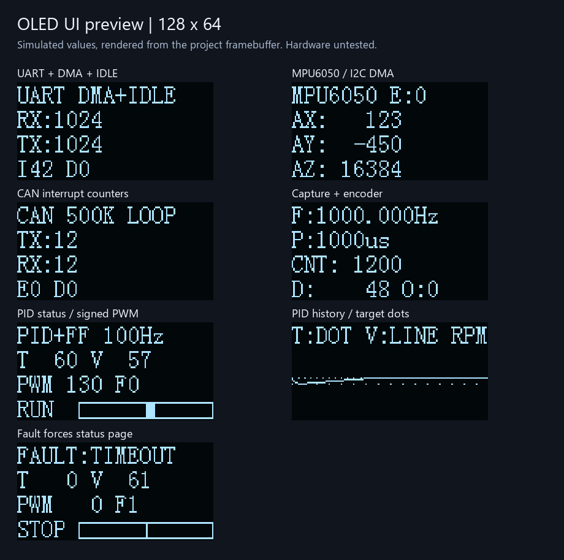

# SPI OLED 接线、显示与刷新机制

## 当前适配范围

用户模块为0.96寸、标注“LTP03A JY”。目前未查到能可靠对应这组丝印的控制器/接口资料，因此实现以**SSD1306兼容、128×64、七针四线SPI模块**为约定，不把丝印当作已确认的芯片型号。

SPI屏的常见接口标识为GND、VCC、D0/CLK、D1/DIN、RES、DC、CS。若模块有接口选择焊盘，应按模块资料设置为四线SPI；若只有GND/VCC/SCL/SDA四针且没有SPI引出，不能仅靠软件切换。

## 第1～6项统一接线

| OLED标识 | STM32 | 作用 |
|---|---|---|
| GND | GND | 共地 |
| VCC | 3.3 V | 使用支持3.3 V供电和逻辑的模块 |
| D0 / CLK / SCLK | PB3 | 重映射后的SPI1_SCK |
| D1 / DIN / MOSI | PB5 | 重映射后的SPI1_MOSI |
| CS | PB0 | 软件片选，低有效 |
| DC / D-C | PB1 | 低为命令，高为显存数据 |
| RES / RST | PB12 | 硬件复位，低有效 |

不使用MISO，不需要IIC地址，也不使用IIC上拉电阻。请按模块引脚丝印逐一对应，不根据针脚物理排列猜线序。

SPI1为单线发送、MSB先行、8位、Mode0；APB2为72MHz，32分频后SCK为2.25MHz。PB3/PB5重映射避免了PA6/PA7编码器冲突；PB12不占电机的PB13 STBY，也不占MPU6050的PB10/PB11。

PB3原为JTAG/SWO相关引脚，因此驱动关闭JTAG，保留PA13/PA14上的SWD下载与调试。Keil使用SW接口，并关闭SWO跟踪，不能同时拿PB3做跟踪输出。

标准库的AFIO重映射调用会涉及SWJ字段，SPI重映射后最后明确配置“关闭JTAG、保留SWD”；CAN工程也先完成CAN重映射，再初始化OLED。后续若增加其他重映射，应保持这个顺序。

## 第7～9项：面包板软件SPI方案

新增FreeRTOS工程将D0接 **PB14**、D1接 **PB15**，另外五根线仍按上表连接。五个控制引脚全部为普通GPIO推挽输出，不初始化SPI外设，也不改动JTAG/SWD映射。PB14在这里是软件时钟，无需对应硬件SPI的SCK功能。

OLED任务独占驱动，1ms分块服务，200ms更新界面；单次最多8字节，不关中断，任务抢占仅延长软件时钟间隔。软件SPI没有硬件TXE/BSY等待，参数合法时直接输出；仍不能检测屏幕是否在线。

第8项复用相同的PB14/PB15软件SPI，改由裸机主循环连续服务，40ms绘制游戏帧；不运行FreeRTOS。摇杆另接PA0/PA1模拟输入及PA2按键输入，详见第8项说明。

第9项沿用第8项接线，新增PA9/PA10串口；100ms更新OLED输入/关节页面。关节反馈失效时清除显示为“--”，显式测试数据页脚为DEMO。

面包板将3.3V和GND接到独立电源轨，屏幕每个引脚落在独立五孔组；不要把多个信号脚放进同一连通电源轨。电源轨可能分段，需要检查通断。第1～6项继续沿用PB3/PB5，换例程时相应换这两根线。

## 各工程显示内容

| 工程 | 屏幕内容 |
|---|---|
| UART | RX前台取出字节、成功提交DMA的TX字节、IDLE、丢弃、错误 |
| IIC/MPU6050 | 最近事务结果和AX/AY/AZ；无有效采样时明确显示NO VALID DATA |
| CAN | 回环/正常模式、成功TX、前台消费RX、错误与丢弃 |
| TIM/编码器 | 频率（含小数）、周期、CNT、增量、捕获覆盖计数 |
| PID电机 | 指令目标/滤波反馈RPM、PWM、运行/故障、双向PWM条形图；自动切换历史曲线 |
| OLED独立例程 | 文字、运行秒数、演示条形图、模拟三角波动画 |
| FreeRTOS | 运行秒数、前台接收字节、LED翻转间隔/状态、RTOS堆余量 |
| 摇杆飞机游戏 | 飞机/随机障碍、分数/等级、暂停/结束/重开、回中校准提示 |
| ROS串口遥控 | 原始/归一化摇杆值、PC/ADC状态、六关节角翻页、NO DATA/OFFLINE/DEMO |

屏幕采用参考教程的8×16字模，四行十六列，仅显示ASCII。源码和说明为中文，界面使用英文缩写，未加入中文字库。

UART的RX/TX是前台处理/提交DMA的累计字节，TX不代表最后一位已经离开发送引脚。UART的I/D和CAN的E/D屏幕紧凑字段取模100000显示；完整计数仍保留在程序中。CAN的D聚合软件队列丢弃和硬件FIFO覆盖计数，详细来源仍可看串口/调试接口。

## 电机状态与历史页

状态页每200ms更新一次：

```text
PID+FF 100Hz
T  60 V  57
PWM 130 F0
RUN  [双向条形图]
```

T是串口指令目标，V是滤波反馈，PWM为千分比。条形图中心为0，左负右正，比例对应±1000，不将限幅后的60%输出画成100%。

正常运行时每4秒在状态/曲线页切换。历史保留32点、200ms采样，约6秒数据；点表示斜坡目标，实线表示滤波后的反馈，纵向范围为配置的±CONTROL_MAX_RPM，超界仅在图上裁切，状态页仍显示数值。任何故障都会固定显示状态页和故障名称，不让曲线遮挡提示。

## 刷新流程与优化

`OLED_Init()` 只初始化SPI、拉低RES和清软件显存；RES低5ms、释放后等100ms由 `OLED_Service()` 分步执行，不阻塞主循环等待上电。

初始化指令分成四段。之后先发送完整显存，再发送AF亮屏命令，减少启动乱码。显示使用1KiB页显存，每页记录变化范围，只发送发生变化的字节。

**单次OLED_Service至多执行一个SPI事务，显存数据最多8字节。** 单笔外设等待共享2ms截止时间，最后等BSY清零再释放CS。全程不关中断、不占DMA、不占控制定时器；界面刷新和GPIO传输只能在主循环调用，不能从ISR调用。

文字覆盖会补足一行的空格，数字变短不会残留旧字符。刷新过程中修改显存会重新登记变化范围，后续轮转页继续发送；不会为显示长时间复制临界区或阻塞控制中断。曲线页需要擦除旧曲线，相比纯数字页会发送更多数据。

SPI超时会记录错误，拉低RES、重置SPI并在约1s后重新初始化，恢复最新界面。软件提供有限等待，不因等待整屏而卡住控制逻辑；实际CPU时间、波形和ISR抖动仍需上板测量。

## 常用接口

```c
OLED_Init();
OLED_PrintLine(1, "RPM:%ld", (long)Speed);  // 行1~4，自动补空格
OLED_ShowString(2, 1, "PWM:");             // 行1~4、列1~16
OLED_DrawPixel(127, 63, 1);
OLED_DrawLine(0, 20, 127, 60, 1);
OLED_DrawBar(40, 52, 88, 11, PWM, 1000);
OLED_Service();                           // 主循环反复调用
```

`OLED_GetReady()` 只表示STM32完成了复位、初始化和初始传输。**单向SPI没有ACK，所以即使未接屏幕也可能Ready=1、错误数为0。** 这不是在线检测，不能用它证明模块型号正确或屏幕已点亮。

## 上板验证顺序

先下载第六个独立OLED例程，再连接到其他实验：

1. 确认七针定义、3.3 V和共地，复位运行。
2. 观察文字页与模拟图形页每4s切换，数字更新没有拖尾。
3. 用逻辑分析仪确认CS低期间有SPI时钟，DC区分命令/数据，RES先低后高。
4. 若空白，先核对控制器/接口选择、RES/DC/CS顺序与SPI模式；不要将Ready=1当作接线正确的依据。
5. 接回原例程，验证UART长流、CAN收发、MPU采样及TIM/电机原有功能；检查新增显示时的10ms控制周期和最大ISR耗时。


